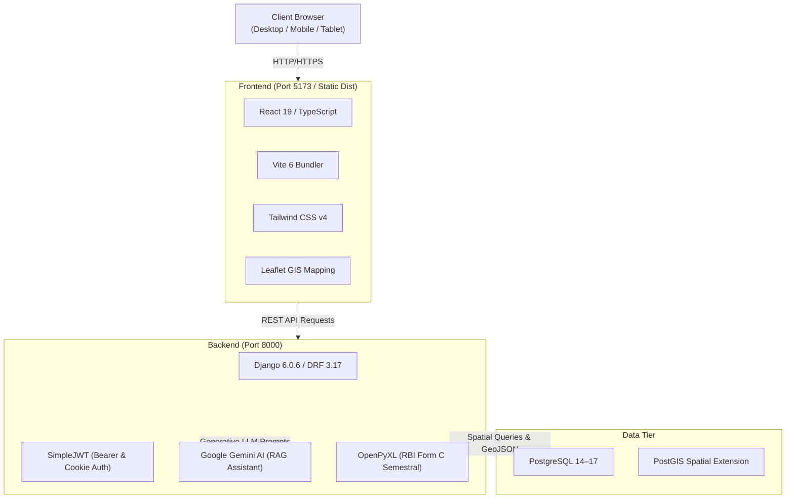

# BarangayKo (BrgyKo) — Complete Hosting, Setup & Dependencies Guide

> **System**: Barangay E-nhabitants Management Information System (BrgyKo)  
> **Jurisdiction**: Barangay San Gabriel, General Trias, Cavite  
> **Repository Structure**: Monorepo (`backend/` Django REST API + `frontend/` React/Vite SPA)  

This guide provides a comprehensive manifest of all system dependencies, prerequisites, and step-by-step instructions to clone, configure, and host the BarangayKo portal on any server (Windows, Ubuntu/Debian Linux, or macOS).

---

## 1. System Architecture & Tech Stack



---

## 2. System Prerequisites

Before running the project, ensure the following core tools are installed on your host machine:

| Tool | Recommended Version | Minimum Version | Verification Command |
| :--- | :--- | :--- | :--- |
| **Python** | `3.12.x` or `3.13.x` | `3.10.x` | `python --version` |
| **Node.js** | `v20.x` or `v22.x` (LTS) | `v18.x` | `node --version` |
| **npm** | `v10.x` | `v9.x` | `npm --version` |
| **PostgreSQL** | `15.x` or `16.x` | `14.x` | `psql --version` |
| **PostGIS** | `3.3+` / `3.4+` | `3.0+` | Installed via package manager or stack builder |
| **Git** | `2.40+` | Any modern | `git --version` |

> [!IMPORTANT]
> **PostGIS & GDAL Native Libraries Required**:  
> Because the system utilizes GeoDjango for spatial household demographic mapping (`geomapping`), PostgreSQL **must** have the **PostGIS** extension installed, and the host system must have **GDAL/GEOS** native binaries.

---

## 3. Complete Dependency Inventory

### 3.1 Backend Dependencies (`backend/requirements.txt`)

The Python backend runs on Django and Django REST Framework. Below is the itemized manifest of all required packages:

| Category | Package Name | Installed Version | Purpose in BarangayKo |
| :--- | :--- | :--- | :--- |
| **Core Web Framework** | `Django` | `6.0.6` | Web framework, ORM, routing, admin, security middleware. |
| | `djangorestframework` | `3.17.1` | REST API serialization, viewsets, authentication, permissions. |
| | `django-cors-headers` | `4.9.0` | Cross-Origin Resource Sharing (CORS) header management. |
| | `django-filter` | `25.2` | URL query parameter filtering for demographic directories. |
| | `asgiref` | `3.11.1` | ASGI specification support for asynchronous operations. |
| | `sqlparse` | `0.5.5` | Non-validating SQL parser used internally by Django ORM. |
| **Database & GIS** | `psycopg2-binary` | `2.9.12` | PostgreSQL database adapter for Python. |
| | `djangorestframework-gis` | `1.2.1` | GeoJSON serializers and spatial filters for GIS mapping. |
| **Security & Auth** | `djangorestframework_simplejwt` | `5.5.1` | JSON Web Token (JWT) access & refresh token authentication. |
| | `PyJWT` | `2.13.0` | Low-level token encoding, decoding, and cryptographic signing. |
| | `cryptography` | `49.0.0` | OpenSSL cryptographic primitives, hashing, and cipher operations. |
| | `django-cryptography` | `1.1` | Database field encryption. |
| | `cffi` | `2.0.0` | C Foreign Function Interface for Python cryptographic bindings. |
| **Audit & Governance** | `django-simple-history` | `3.13.0` | Full database audit logging (`HistoricalRecords`), capturing every change to personnel, residents, and documents. |
| | `django-appconf` | `1.2.0` | Helper application configuration for simple-history. |
| **Spreadsheet & Reports** | `openpyxl` | `3.1.5` | Reads, generates, and formats RBI Form C (Revised 2024) Semestral Reports and handles bulk resident Excel imports/exports. |
| | `et_xmlfile` | `2.0.0` | Low-memory XML parser engine used by openpyxl. |
| **Media & Images** | `pillow` | `12.3.0` | Image processing, resizing, and validation for uploaded resident government IDs and official council portraits. |
| **AI Assistant** | `google-generativeai` | `0.8.6` | Official SDK for Google Gemini models (powers the Barangay AI Assistant RAG queries). |
| | `google-ai-generativelanguage`| `0.6.15` | Low-level gRPC client for Google AI generative language models. |
| | `google-api-python-client` | `2.198.0` | Google API Client Library for Python. |
| | `google-auth` | `2.55.2` | Authentication library for Google Cloud and Google APIs. |
| | `google-auth-httplib2` | `0.4.0` | Google Auth transport adapter for httplib2. |
| | `googleapis-common-protos` | `1.75.0` | Common protocol buffer definitions for Google APIs. |
| | `grpcio` / `grpcio-status` | `1.82.1` | High-performance RPC framework for Gemini API connectivity. |
| | `protobuf` | `5.29.6` | Protocol Buffers data serialization library. |
| | `proto-plus` | `1.28.1` | Beautiful Pythonic wrapper for Google Protocol Buffers. |
| **Networking & HTTP** | `requests` | `2.34.2` | Synchronous HTTP library for external web queries. |
| | `urllib3` | `2.7.0` | HTTP client with connection pooling and SSL verification. |
| | `httplib2` | `0.32.0` | Comprehensive HTTP client library. |
| | `certifi` | `2026.6.17` | Mozilla CA certificate bundle for validating SSL/TLS certs. |
| | `charset-normalizer` | `3.4.9` | Character encoding detection library. |
| | `idna` | `3.18` | Internationalized Domain Names in Applications (RFC 5891). |
| **Async & Schedulers** | `channels` | `4.3.1` | Asynchronous WebSocket and protocol handling for Django. |
| | `channels_redis` | `4.3.0` | Redis channel layer backend for Django Channels. |
| | `redis` | `7.0.1` | Python Redis client for caching and pub/sub. |
| | `APScheduler` | `3.11.3` | In-process cron scheduler for automated demographic snapshots. |
| **Environment & Typing** | `python-dotenv` | `1.2.2` | Loads configuration from `.env` into `os.environ`. |
| | `pydantic` / `pydantic_core` | `2.13.4` | Data validation and parsing using Python type hints. |
| | `pytz` / `tzdata` | `2026.2` | World timezone definitions (enforces `Asia/Manila` time). |
| | `typing_extensions` | `4.16.0` | Backported standard typing module enhancements. |

---

### 3.2 Frontend Dependencies (`frontend/package.json`)

The frontend is a single-page application built with React 19, TypeScript, Vite 6, and Tailwind CSS v4.

#### Production Dependencies:
| Package Name | Version | Purpose in BarangayKo |
| :--- | :--- | :--- |
| `react` | `^19.2.6` | Core component UI framework. |
| `react-dom` | `^19.2.6` | DOM renderer for React. |
| `react-router-dom` | `^7.18.0` | Client-side routing, protected navigation guards, URL parameters. |
| `axios` | `^1.18.0` | HTTP client with automatic JWT token refresh & Bearer header injection. |
| `lucide-react` | `^1.21.0` | Modern SVG iconography library. |
| `leaflet` | `^1.9.4` | Interactive mobile-friendly GIS mapping library. |
| `react-leaflet` | `^5.0.0` | React bindings for Leaflet map elements. |
| `react-leaflet-cluster` | `^4.1.3` | Marker clustering plugin for GIS households. |
| `leaflet-geosearch` | `^4.4.0` | Address search and geocoding controls for Leaflet. |
| `recharts` | `^3.9.2` | Composable charting library for demographic age/sector visualizations. |
| `react-big-calendar` | `^1.20.0` | Full monthly/weekly calendar widget for official barangay events. |
| `date-fns` | `^4.4.0` | Modern JavaScript date utility library. |
| `react-markdown` | `^10.1.0` | Markdown rendering engine for AI assistant chat responses. |
| `jwt-decode` | `^4.0.0` | Client-side JWT payload decoding (extracts user roles and expiry). |
| `xlsx` | `^0.18.5` | Client-side spreadsheet parsing and generation. |
| `pdf-lib` | `^1.17.1` | Client-side PDF generation for clearances and certificates. |
| `react-to-print` | `^3.3.0` | Browser print utility for official certificates and Form C documents. |
| `@tailwindcss/vite` | `^4.3.1` | High-performance Vite plugin for Tailwind CSS v4. |

#### Development & Build Dependencies:
| Package Name | Version | Purpose |
| :--- | :--- | :--- |
| `vite` | `^8.0.12` | Modern lightning-fast frontend dev server & production bundler. |
| `typescript` | `~6.0.2` | Static type checker for TypeScript. |
| `tailwindcss` | `^4.3.1` | Utility-first CSS styling framework. |
| `@vitejs/plugin-react` | `^6.0.1` | Vite official plugin for React Fast Refresh and JSX transformation. |
| `@types/react` | `^19.2.14` | TypeScript type declarations for React. |
| `@types/react-dom` | `^19.2.3` | TypeScript type declarations for React DOM. |
| `@types/leaflet` | `^1.9.21` | TypeScript type declarations for Leaflet GIS. |
| `@types/node` | `^24.12.3` | TypeScript type declarations for Node.js runtime. |
| `eslint` | `^10.3.0` | Code linter for JavaScript and TypeScript. |
| `postcss` / `autoprefixer`| `^8.5.15` / `^10.5.0` | CSS transformations and browser vendor prefixing. |

---

## 4. Step-by-Step Installation & Setup Guide

### Step 1: Clone the Repository
```bash
git clone https://github.com/<your-username>/Capstone-Project.git
cd "Capstone Project"
```

---

### Step 2: PostgreSQL & PostGIS Database Setup

1. **Start the PostgreSQL Service**:
   - **Linux**: `sudo systemctl start postgresql`
   - **Windows**: Start via Windows Services (`services.msc`)
   - **macOS**: `brew services start postgresql@16`

2. **Install PostGIS (If not already installed)**:
   - **Ubuntu/Debian**:
     ```bash
     sudo apt-get update
     sudo apt-get install postgresql-contrib postgis postgresql-16-postgis-3 gdal-bin libgdal-dev
     ```
   - **Windows**: Use the **Stack Builder** tool included with the PostgreSQL installer to install the **Spatial Extensions > PostGIS** bundle.
   - **macOS**:
     ```bash
     brew install postgis gdal
     ```

3. **Create the Database and Enable PostGIS**:
   Open a terminal and connect to PostgreSQL as superuser:
   ```bash
   psql -U postgres
   ```
   Execute the following SQL commands:
   ```sql
   -- Create database
   CREATE DATABASE brgykodb;

   -- Connect to the database
   \c brgykodb;

   -- Enable the PostGIS spatial extension (REQUIRED)
   CREATE EXTENSION postgis;

   -- Verify PostGIS installation
   SELECT PostGIS_Version();

   -- Exit psql
   \q
   ```

---

### Step 3: Backend Configuration & Setup

1. **Navigate to the Backend Directory**:
   ```bash
   cd backend
   ```

2. **Create and Activate a Virtual Environment**:
   - **Windows (PowerShell)**:
     ```powershell
     python -m venv env
     .\env\Scripts\Activate.ps1
     ```
   - **Linux / macOS**:
     ```bash
     python3 -m venv env
     source env/bin/activate
     ```

3. **Install Backend Dependencies**:
   ```bash
   pip install --upgrade pip
   pip install -r requirements.txt
   ```

4. **Configure Environment Variables**:
   Copy the provided `.env.example` to `.env`:
   - **Windows**: `copy .env.example .env`
   - **Linux / macOS**: `cp .env.example .env`

   Edit `backend/.env` with your settings:
   ```ini
   # Django Secret Key (generate a random string for production)
   DJANGO_SECRET_KEY=generate-a-secure-50-character-secret-key-here

   # Set to True for development, False for production
   DJANGO_DEBUG=True

   # Allowed Hosts (comma-separated list of IPs / domains)
   DJANGO_ALLOWED_HOSTS=localhost,127.0.0.1,.trycloudflare.com

   # PostgreSQL / PostGIS Database Connection
   DB_NAME=brgykodb
   DB_USER=postgres
   DB_PASSWORD=root
   DB_HOST=localhost
   DB_PORT=5432

   # Google Gemini API Key (Required for AI Assistant Chatbot)
   # Get a key from https://aistudio.google.com/
   GOOGLE_API_KEY=your_actual_gemini_api_key
   ```

   > [!TIP]
   > To customize the database password, edit the `DATABASES` dictionary in [`backend/backend/settings.py`](file:///c:/VSCode%20Projects/Capstone%20Project/backend/backend/settings.py#L124) or connect via the environment variables listed above.

5. **Run Database Migrations**:
   ```bash
   python manage.py migrate
   ```

6. **Create the Initial Superuser (Administrator)**:
   ```bash
   python manage.py createsuperuser
   ```
   *Follow the prompts to enter a username, email, and password.*

---

### Step 4: Frontend Configuration & Setup

1. **Open a New Terminal and Navigate to Frontend**:
   ```bash
   cd frontend
   ```

2. **Install Node Packages**:
   ```bash
   npm install
   ```

3. **Configure Frontend Environment Variables**:
   Copy `.env.example` to `.env`:
   - **Windows**: `copy .env.example .env`
   - **Linux / macOS**: `cp .env.example .env`

   Edit `frontend/.env`:
   ```ini
   # Points to your Django backend URL (no trailing slash)
   VITE_API_URL="http://localhost:8000"
   ```

4. **Verify Frontend Build**:
   ```bash
   npm run build
   ```
   *This compiles the TypeScript code through Vite and verifies zero type or syntax errors.*

---

## 5. Running the Application

### 5.1 Local Development Mode

Start both servers concurrently in separate terminal windows:

* **Terminal 1 (Backend)**:
  ```bash
  cd backend
  # Activate virtual environment if not already active
  python manage.py runserver 0.0.0.0:8000
  ```
  *Backend will be running at `http://localhost:8000/`.*

* **Terminal 2 (Frontend)**:
  ```bash
  cd frontend
  npm run dev
  ```
  *Frontend will be running at `http://localhost:5173/`.*

Now open your browser and navigate to:  
👉 **`http://localhost:5173/`**

---

### 5.2 Remote Hosting & Cloudflare Tunnels

If hosting the system publicly using Cloudflare Quick Tunnels:

1. **Start Backend Quick Tunnel**:
   ```bash
   cloudflared tunnel --url http://localhost:8000
   ```
   *Note the assigned URL, e.g. `https://my-backend-tunnel.trycloudflare.com`.*

2. **Update Frontend `.env`**:
   In `frontend/.env`, set:
   ```ini
   VITE_API_URL="https://my-backend-tunnel.trycloudflare.com"
   ```

3. **Start Frontend Quick Tunnel**:
   ```bash
   cloudflared tunnel --url http://localhost:5173
   ```
   *Access the application via the frontend tunnel URL.*

---

## 6. Pre-Configured Test Accounts & User Roles

The portal implements 4 standardized user roles:

| Role | Role Code | Access Permissions | Primary Portal Modules |
| :--- | :--- | :--- | :--- |
| **Administrator** | `ADMIN` | Full clearance across all modules, personnel management, audit logs, and settings. | Admin Hub, Reports, Demographics, Directory, Calendar |
| **Staff Member** | `STAFF` | Operational management of residents, announcements, records, and calendar. | Residents Directory, Reports, Documents, Staff Calendar |
| **Punong Barangay** | `CAPTAIN` | Executive approvals, council oversight, report submissions, official announcements. | Residents Approvals, Reports Signatories, Council Directory |
| **Resident / Public** | `RESIDENT` | Unauthenticated public visitor / verified citizen viewing public announcements. | Dashboard, Public Calendar, AI Assistant, Emergency SOS |

> [!IMPORTANT]
> **Single Punong Barangay Rule**:  
> The system strictly enforces that **only one active account with the Punong Barangay (Captain) role can exist at any time**. To register or elevate a new Captain, the existing Captain account must be deactivated or deleted first via the Admin Command Center (`/adminhub`).

---

## 7. Common Troubleshooting & FAQs

### Q1: `django.core.exceptions.ImproperlyConfigured: GEOS/GDAL library not found`
* **Cause**: GeoDjango cannot locate the native spatial C libraries on your operating system.
* **Fix on Windows**: Add OSGeo4W or PostgreSQL bin directory (which contains `gdal.dll`, `geos_c.dll`) to your system `PATH`, or set `GDAL_LIBRARY_PATH` in `settings.py`:
  ```python
  import os
  if os.name == 'nt':
      GEOS_LIBRARY_PATH = r"C:\Program Files\PostgreSQL\16\bin\libgeos_c.dll"
      GDAL_LIBRARY_PATH = r"C:\Program Files\PostgreSQL\16\bin\gdal.dll"
  ```
* **Fix on Ubuntu / Debian**:
  ```bash
  sudo apt-get install binutils libproj-dev gdal-bin libgdal-dev
  ```

### Q2: `psycopg2.OperationalError: connection to server on socket failed`
* **Cause**: PostgreSQL service is stopped or port 5432 is blocked.
* **Fix**: Ensure PostgreSQL is running (`sudo systemctl status postgresql` or Windows Services) and that the password in `backend/.env` matches your postgres superuser password.

### Q3: `CORS Error / Network Error on Login`
* **Cause**: The frontend is sending requests to an API URL not allowed in Django's CORS whitelist, or `VITE_API_URL` does not match the running backend port.
* **Fix**: Ensure `frontend/.env` has `VITE_API_URL="http://localhost:8000"` (without trailing slash) and check that `CORS_ALLOW_ALL_ORIGINS = True` or the proper domain is listed in `backend/backend/settings.py`.

### Q4: `openpyxl.utils.exceptions.InvalidFileException` on Form C Download
* **Cause**: The Excel template file `BarangayKo Form C.xlsx` is missing from `backend/api/`.
* **Fix**: Ensure `backend/api/BarangayKo Form C.xlsx` exists in your repository. It is included in the project root and tracked by git.
